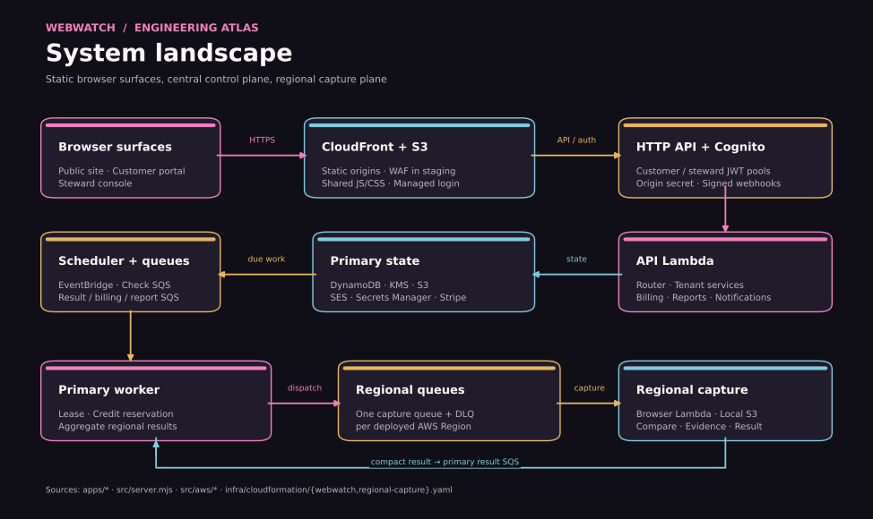
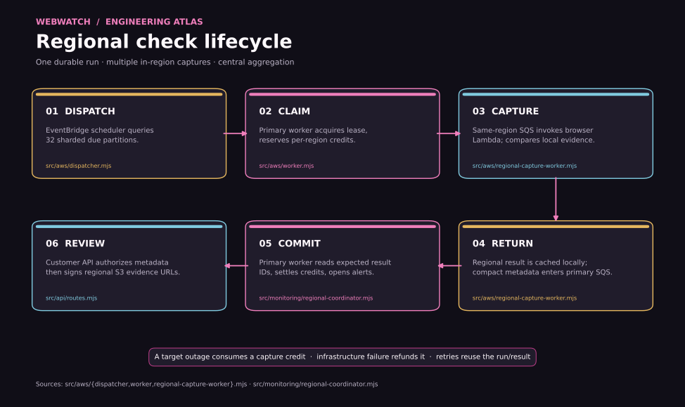

# Visual architecture atlas

The figures are generated by `scripts/generate-architecture.py` and the paired HTML files are standalone, brand-styled lead developer references with notes and source pointers.

| View | Standalone HTML | Drawing | Best used for |
| --- | --- | --- | --- |
| System landscape | [Open system map](system-landscape.html) | [SVG](system-landscape.svg) · [PNG](system-landscape.png) | Service boundaries and responsibility |
| Regional check | [Open check flow](regional-check.html) | [SVG](regional-check.svg) · [PNG](regional-check.png) | Queue lifecycle, evidence locality and aggregation |

Consult [architecture](../architecture.md) for transaction details and [CloudFormation inventory](../reference/cloudformation.md) for resource conditions.
